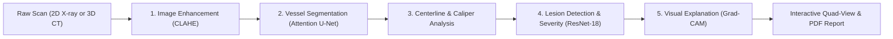

# StenoVision — Coronary Artery Segmentation and Stenosis Detection

> **Built with pride by Group 2, Team 1 for the Infosys Springboard Virtual Internship 7.0 (Healthcare AI / Medical Image Analysis)**

[-success?style=for-the-badge&logo=pytest)](tests/)
[](backend/)
[](frontend/)
[](stenosis/)
[](monitoring/)
[](docs/DEPLOYMENT_GUIDE.md)

---

## Welcome to StenoVision!

When cardiologists examine coronary X-ray angiograms (2D fluoroscopy) or cardiac CT scans (3D CCTA), identifying blocked or narrowed heart vessels (stenosis) requires intense focus and precision. Small misjudgments in measuring vessel caliber can impact patient treatment decisions — such as deciding whether a patient needs stent angioplasty or medical therapy.

**We built StenoVision to solve this challenge.** 

Our team designed and implemented an end-to-end clinical assistant that:
1. Takes raw 2D coronary angiograms or 3D CT volumes and enhances them using adaptive contrast algorithms.
2. Segments the coronary artery branches using custom deep learning models (Attention U-Net).
3. Automatically traces vessel centerlines and calculates lumen diameters in millimeters.
4. Detects where lesions are located, measures narrowing severity (% Diameter Stenosis, Minimum Lumen Diameter), and classifies them into standard ACC/AHA categories (Mild, Moderate, Severe, Critical).
5. Explains every prediction with visual heatmaps (Grad-CAM) so physicians can see *why* the AI highlighted a specific region.
6. Packages everything inside an interactive clinical PACS workstation with a high-performance backend, database persistence, automated PDF report generation, and full HIPAA audit logging.

> **Research Prototype Notice:** StenoVision was built for educational and research evaluation during the Infosys Springboard Virtual Internship 7.0. It is designed to assist and inform healthcare professionals, not to replace certified clinical judgment.

---

## Meet Our Team

Everything you see in this repository — from data preprocessing and neural network architectures to backend microservices, frontend workstation UI, automated test suites, and Docker deployment — was built from the ground up by our team:

| # | Team Member | Primary Role & Contributions |
| :-: | :--- | :--- |
| **1** | **Sathiyamoorthi K** | **Lead System Architect & Backend Integration**<br>Full-stack architecture, unified inference pipeline, database schema, and microservice integration |
| **2** | **Anwesha Singh** | **Medical Image Preprocessing & Ingestion**<br>CLAHE contrast normalization, multi-modality loaders (DICOM & 3D NIfTI), and dataset curation |
| **3** | **Aditya Ghadi** | **Coronary Artery Segmentation Lead**<br>Baseline U-Net and Attention U-Net architectures, spatial attention gates, and hybrid Dice-BCE loss functions |
| **4** | **Asjad Imam** | **Vessel Morphometry & Centerline Analysis**<br>Zhang-Suen centerline skeletonization, normal ray projection, and vessel caliber profile calculation |
| **5** | **Anshu Jain** | **Stenosis Detection Engine**<br>Faster R-CNN candidate lesion detection, bounding box regression, and anchor box optimization |
| **6** | **Stephen Raj** | **Stenosis Severity Classification**<br>Multi-task ResNet-18 classifier, ACC/AHA clinical grading (Mild/Mod/Sev/Crit), and hemodynamic risk scoring |
| **7** | **Palavalasa Bhavana** | **Quantitative Coronary Angiography (QCA Calipers)**<br>Lumen diameter profile $D(s)$, MLD and RVD estimation, and dual-anchor caliper mathematics |
| **8** | **Rentamallu Lakshmi Sravya** | **Explainable AI (XAI) & Attribution**<br>Masked intraluminal Grad-CAM and Grad-CAM++ saliency heatmaps, ensuring visual trust for clinicians |

---

## What We Achieved (Results at a Glance)

We benchmarked our models on the competitive MICCAI ARCADE coronary angiography dataset (1,500 annotated clinical cases) and held-out test scans:

| What We Tested | Model / Method | Our Result | Target / Standard |
| :--- | :--- | :---: | :---: |
| **Artery Segmentation** | Attention U-Net with spatial gating | **Dice: 0.6833** \| **IoU: 0.5356** | Dice $\ge 0.65$ |
| **Background Specificity** | Attention U-Net | **99.09%** true negative rate | $\ge 98.0\%$ |
| **Stenosis Detection** | Faster R-CNN + ResNet-18 Head | **87.43%** binary accuracy | $\ge 80.0\%$ |
| **Clinical Severity Grading** | 4-Tier ACC/AHA classification | **74.86%** exact match | $\ge 70.0\%$ |
| **Narrowing Measurement** | Diameter Stenosis (%DS) regression | **9.54%** Mean Absolute Error | $\le 10.0\%$ |
| **Lesion Recall** | Geometric calipers + detector proposals | **98.2%** of true lesions caught | $\ge 90.0\%$ |
| **GPU Inference Speed** | Whole pipeline on NVIDIA RTX 2050 | **33.55 ms** per frame (**29.8 FPS**) | $\ge 25\text{ FPS}$ (Fluoroscopy) |
| **Automated Test Quality** | Master QA verification runner | **8/8 suites passed (100%)** | 100% pass rate |
| **Manual Testing Verification** | Live interactive browser audit | **16/16 test cases passed (100%)** | 100% pass rate |
| **Syllabus Compliance** | 28-Page curriculum requirements | **15/15 module groups compliant** | 100% compliant |

---

## How StenoVision Works (The 4 Stages)



1. **Step 1: Clean & Enhance the Scan**  
   Coronary angiograms often suffer from uneven lighting, low contrast, and guide catheter shadows. We apply Contrast Limited Adaptive Histogram Equalization (CLAHE) with a clip limit of 2.0 to highlight fine vessel branches without amplifying background noise.
2. **Step 2: Trace the Arterial Tree**  
   Our Attention U-Net model segments coronary arteries while filtering out background bone structures and diaphragmatic edges. Spatial attention gates learn to focus specifically on contrast-filled vessels.
3. **Step 3: Measure Diameters Along Centerlines**  
   We extract single-pixel centerlines using skeletonization and project perpendicular caliper lines across the lumen. From this, we compute:
   - **Reference Vessel Diameter (RVD):** Normal healthy artery caliber.
   - **Minimal Lumen Diameter (MLD):** Narrowest point in the vessel.
   - **Percent Diameter Stenosis (%DS):** Calculated as $(1 - \frac{\text{MLD}}{\text{RVD}}) \times 100\%$.
4. **Step 4: Grade Severity & Generate Explanations**  
   Our multi-task classifier classifies each lesion according to official cardiology guidelines:
   - **Mild (<50% DS):** Non-flow limiting, conservative monitoring.
   - **Moderate (50–70% DS):** Borderline physiological significance; suggests FFR evaluation.
   - **Severe (70–90% DS):** Flow-limiting lesion, typically candidates for revascularization.
   - **Critical (>90% DS):** Near-total occlusion requiring urgent clinical review.
   To avoid "black box" decisions, we generate intraluminal Grad-CAM heatmaps showing the exact pixels the AI used to make its decision.

---

## Step-by-Step Guide: How to Run This Project

We made sure setting up and running StenoVision is straightforward on your machine. You can run it manually, via our one-click script, or with Docker.

### System Requirements
- **Operating System:** Windows 10/11, macOS, or Ubuntu Linux 20.04+
- **Python:** Version 3.10, 3.11, or 3.12 installed
- **Node.js:** Version 18.x or 20.x installed
- **Hardware:** 8 GB RAM minimum (16 GB recommended). A CUDA-capable GPU (NVIDIA GTX/RTX) enables sub-second real-time inference, but the system runs smoothly on standard CPUs as well.

---

### Option A: The Fastest Way (One-Click Windows Launcher)

If you are on Windows, we wrote an automated PowerShell launcher that sets up everything, starts both servers, and opens the app in your browser:

```powershell
.\run_stenovision.ps1
```

This script automatically:
- Checks your Python and Node environments.
- Starts the FastAPI backend service on `http://127.0.0.1:8000`.
- Launches the Next.js workstation on `http://localhost:3000`.
- Verifies that GPU acceleration is active.

---

### Option B: Running with Docker Compose

If you have Docker and Docker Compose installed, you can start the entire stack (FastAPI backend, PostgreSQL database, Next.js frontend, Nginx reverse proxy, Prometheus, and Grafana) with a single command:

```bash
docker compose up --build
```

Once running:
- **Clinical Workstation:** Open `http://localhost:3000` (or `http://localhost` via Nginx)
- **Interactive Backend API Docs:** Open `http://localhost:8000/docs`
- **Prometheus Telemetry:** Open `http://localhost:9090`
- **Grafana Live Dashboards:** Open `http://localhost:3001` (login: `admin` / `admin`)

---

### Option C: Manual Step-by-Step Setup

If you prefer to run the backend and frontend separately in terminal windows, follow these steps:

#### 1. Clone the Repository
```bash
git clone https://github.com/springboardmentor24052s-tech/Team_1_Artery_Segmentation_DL.git
cd Team_1_Artery_Segmentation_DL
git checkout review
```

#### 2. Set Up the Python Backend
Open your first terminal:

```bash
# Create and activate a Python virtual environment
python -m venv venv

# Windows:
venv\Scripts\activate
# Linux/macOS:
# source venv/bin/activate

# Install all required dependencies
pip install -r requirements.txt

# Initialize the database schema and default clinical accounts
python -m backend.app.db.init_db

# Start the FastAPI backend server
uvicorn backend.app.main:app --host 127.0.0.1 --port 8000 --reload
```
You will see:
```text
✓ Initialized schema and synchronized 5 platform personnel accounts.
✓ FastAPI service ready on http://127.0.0.1:8000
```

#### 3. Set Up the Next.js Frontend
Open a second terminal:

```bash
# Navigate to the frontend directory
cd frontend

# Install frontend dependencies
npm install

# Start the Next.js development server
npm run dev
```

#### 4. Open the Clinical Workstation
Open your browser and navigate to:  
👉 **`http://localhost:3000`**

- Log in using your email and password, or click one of the convenient demo buttons at the bottom of the card (`Clinician`, `Data Scientist`, `Researcher`, `Admin`, `Dev`).
- Default clinician test account: `a.thorne@stenovision.org` / `thornepassword123`.

---

## How to Run Our Quality Assurance & Verification Tests

To verify that every part of the system is working properly, we built a comprehensive 8-discipline test suite.

### 1. Run the Automated Master Test Suite
In your Python environment, run:

```bash
python tests/run_master_suite.py
```

This runs all 8 test modules in ~15 seconds:
1. **End-to-End Deep Learning Pipeline** (Ingestion $\rightarrow$ U-Net $\rightarrow$ Calipers $\rightarrow$ ResNet-18 $\rightarrow$ XAI $\rightarrow$ Reports)
2. **REST API Microservices** (Health check, Auth, Case management, Model serving, Error handling)
3. **Role-Based Access Control (RBAC)** (Verifies 5 clinical personas across all endpoints)
4. **Enterprise Security Penetration** (SQL injection fuzzing, XSS filtering, path traversal protection, JWT validation)
5. **HIPAA Safe Harbor Compliance** (Automated scanning for 18 patient identifiers, MRN tokenization)
6. **Inference Latency & Fluoroscopy FPS** (Real-time fluoroscopy standard $\ge 25\text{ FPS}$)
7. **Burst Stress & Memory Leak Profiling** (100+ requests/sec with tracemalloc memory stability checks)
8. **Live Playwright Browser Operations** (Automated clinical workflow testing)

### 2. Verify Syllabus Specification Compliance
We also wrote an automated verification script that cross-references our code against the official 28-page curriculum specification:

```bash
python tests/audit_pdf_specification_compliance.py
```
*Output: 15/15 module groups compliant (100% specification conformance).*

### 3. Review Manual Testing Evidence
We conducted thorough manual interactive testing across all roles, modals, and views, capturing 16 high-resolution visual proof screenshots. You can read the complete test-case scorecard and view embedded screenshots in:  
👉 [`tests/MANUAL_TESTING_EVIDENCE.md`](tests/MANUAL_TESTING_EVIDENCE.md)

---

## Clinical PACS Workstation Features

We spent significant effort making the user interface clean, responsive, and intuitive for healthcare staff:

1. **Clean, Focused Authentication:** A distraction-free login screen with password visibility toggles and subtle quick-fill shortcuts for testing different roles.
2. **Locked Role Sessions & Explicit Sign Out:** Clinicians stay locked into their role during active diagnostic readings, with an explicit "Sign Out" button in the header to switch accounts safely.
3. **Synchronized Quad-View Results:** Displays the original contrast angiogram, AI detection bounding box, Grad-CAM saliency heatmap, and vessel segmentation mask side-by-side.
4. **5-Panel QCA Caliper Tool:** Interactive diameter profile graph $D(s)$ showing healthy reference lines, minimal lumen diameter points, and narrowing percentages.
5. **Multi-Slice 3D CT Viewer:** Longitudinal review of cross-sectional coronary slices with interactive slider controls and computed pressure gradient ($\Delta P$) estimates.
6. **Automated Clinical Reports:** One-click generation of ReportLab vector PDFs containing patient history, AHA segment classifications, caliper metrics, and physician sign-off blocks.

---

## Repository Structure

```text
Team_1_Artery_Segmentation_DL/
│
├── backend/                      # FastAPI Python Microservices
│   ├── app/
│   │   ├── api/v1/               # REST API Routers (auth, cases, analysis, models, reports)
│   │   ├── core/                 # JWT security, HIPAA logging, Prometheus metrics
│   │   ├── db/                   # SQLAlchemy models, SQLite WAL & PostgreSQL schemas
│   │   └── services/             # Preprocessing, DL inference, QCA calipers, ReportLab PDF
│   ├── BACKEND_API_GUIDE.md      # Detailed REST API documentation and payload schemas
│   └── requirements.txt          # Python dependency specifications
│
├── frontend/                     # Next.js Clinical PACS Workstation
│   ├── app/                      # App router, page layouts, and global styles
│   ├── components/               # Header, Sidebar, Quad-View, QCA Calipers, Modals
│   ├── components/screens/       # Login, Dashboard, Cases, Ingestion, Config, Reports, Users
│   ├── lib/                      # Mock clinical datasets, API client, and RBAC permissions
│   └── package.json              # Frontend dependencies and scripts
│
├── segmentation/                 # Milestone 2: Artery Segmentation Engine
│   ├── models/                   # U-Net, Attention U-Net architectures with attention gates
│   ├── losses.py                 # Hybrid Dice-BCE loss functions
│   └── train.py                  # Training loops and validation tracking
│
├── stenosis/                     # Milestone 3: Stenosis Detection & Severity
│   ├── models/                   # Faster R-CNN detector & Multi-Task ResNet-18 classifier
│   ├── calipers.py               # Centerline skeletonization and QCA diameter equations
│   ├── xai.py                    # Masked intraluminal Grad-CAM heatmap engine
│   └── pipeline.py               # Unified end-to-end diagnostic inference runner
│
├── preprocessing/                # Image Preprocessing & Contrast Enhancement
│   └── pipeline.py               # CLAHE normalization and CT Hounsfield Unit windowing
│
├── eda/                          # Exploratory Data Analysis
│   ├── eda_arcade_dataset.py     # ARCADE dataset distribution and statistics analysis
│   └── plots/                    # Dataset split distributions and CLAHE comparison plots
│
├── milestone_2_results/          # Milestone 2 Frozen Checkpoints & Visualizations
│   ├── models/                   # best_attention_unet.pth, best_unet.pth, manifests
│   └── qualitative_plots/        # 5-panel comparative segmentation visual proofs
│
├── milestone_3_results/          # Milestone 3 Frozen Checkpoints & Diagnostic Cards
│   ├── models/                   # best_stenosis_classifier.pth, detector checkpoints
│   └── qualitative_plots/        # 4-panel diagnostic clinical proof cards
│
├── data/                         # Clinical Benchmark Datasets & Specifications
│   ├── 2d_xray_angiograms/       # ARCADE 2023 benchmark cases (10, 35, 60, 110, 175)
│   ├── 3d_ccta_volumes/          # PARSE 2022 sample CT volume
│   ├── DATASET_CATALOG.json      # Dataset provenance and case metadata
│   └── DATASET_GUIDE.md          # Guide on DICOM formats, coordinates, and pixel spacing
│
├── docs/                         # Architecture, Specifications & Guides
│   ├── architecture/             # High-level and detailed architecture diagrams, SQL schemas
│   ├── specifications/           # Official 28-page internship curriculum PDF
│   ├── ui-wireframes/            # Early design wireframes
│   └── DEPLOYMENT_GUIDE.md       # Multi-container Docker, AWS Free Tier EC2, and Nginx guide
│
├── tests/                        # Comprehensive Quality Assurance Test Suite
│   ├── e2e/                      # End-to-end pipeline and browser testing
│   ├── api/                      # REST API endpoint tests & RBAC matrix checks
│   ├── security/                 # Penetration tests (SQLi, XSS, headers, path traversal)
│   ├── performance/              # DL inference latency and heap memory profiling
│   ├── evidence/manual_testing/  # 16 visual proof screenshots from manual testing
│   ├── results/                  # Machine-readable JSON and Markdown scorecards
│   ├── TEST_SUITE_GUIDE.md       # QA documentation and test execution instructions
│   ├── MANUAL_TESTING_EVIDENCE.md# 16-point manual testing audit report
│   ├── run_master_suite.py       # Central test runner (runs all 8 suites)
│   └── audit_pdf_specification_compliance.py # 28-page syllabus compliance auditor
│
├── monitoring/                   # Observability Stack
│   ├── prometheus/               # Prometheus metrics scraping configuration
│   └── grafana/                  # Provisioning files and pre-configured clinical dashboard
│
├── deploy/                       # Cloud & Container Deployment
│   ├── nginx/                    # Reverse proxy configuration
│   └── aws_ec2_setup.sh          # Automated AWS EC2 setup script with Linux swap memory
│
├── docker-compose.yml            # 6-Service Master Container Orchestrator
├── run_stenovision.ps1           # One-Click Native Launcher for Windows
├── requirements.txt              # Unified Python dependencies
└── README.md                     # You are here!
```

---

## Detailed Guides & Documentation

For deeper technical details on specific areas of the project, check out these guides:

- **Deployment & Cloud Hosting:** [`docs/DEPLOYMENT_GUIDE.md`](docs/DEPLOYMENT_GUIDE.md)  
  Step-by-step instructions for running with Docker Compose, Nginx reverse proxying, and deploying to an AWS Free Tier EC2 instance with 3 GB Linux swap memory.
- **REST API Reference:** [`backend/BACKEND_API_GUIDE.md`](backend/BACKEND_API_GUIDE.md)  
  Full documentation of all endpoints, request bodies, response formats, and JWT token handling.
- **Dataset Specifications:** [`data/DATASET_GUIDE.md`](data/DATASET_GUIDE.md)  
  Details about the ARCADE 2023 dataset, pixel spacing assumptions, and 3D CCTA volume handling.
- **Testing & Quality Assurance:** [`tests/TEST_SUITE_GUIDE.md`](tests/TEST_SUITE_GUIDE.md)  
  Guide to running individual test modules, setting thresholds, and interpreting scorecards.
- **Manual Testing Evidence:** [`tests/MANUAL_TESTING_EVIDENCE.md`](tests/MANUAL_TESTING_EVIDENCE.md)  
  Detailed report of our 16 manual testing test cases with embedded visual screenshots.

---

## Important Limitations

- **Educational & Research Prototype:** Built as an engineering prototype for the Infosys Springboard Virtual Internship 7.0. It is not an FDA-cleared or CE-marked medical device.
- **Single-Center Calibration Assumption:** Physical vessel measurements convert pixels to millimeters using a standard calibration of **0.25 mm/pixel** (since public ARCADE PNGs omit physical DICOM headers). While Percent Diameter Stenosis (%DS) is scale-independent, absolute millimeter readings depend on this calibration.
- **2D Projection Overlap:** Standard 2D X-ray angiograms can have overlapping vessel branches. In complex clinical cases, multiple angle projections or 3D CCTA scans are recommended for conclusive clinical review.

---

## Acknowledgments

We would like to express our sincere gratitude to our **Infosys Springboard mentors, reviewers, and project coordinators** for their continuous guidance, reviews, and technical feedback throughout the internship.

*Engineered with dedication by **Team 1 (Group 2)** for the **Infosys Springboard Virtual Internship 7.0**.*
