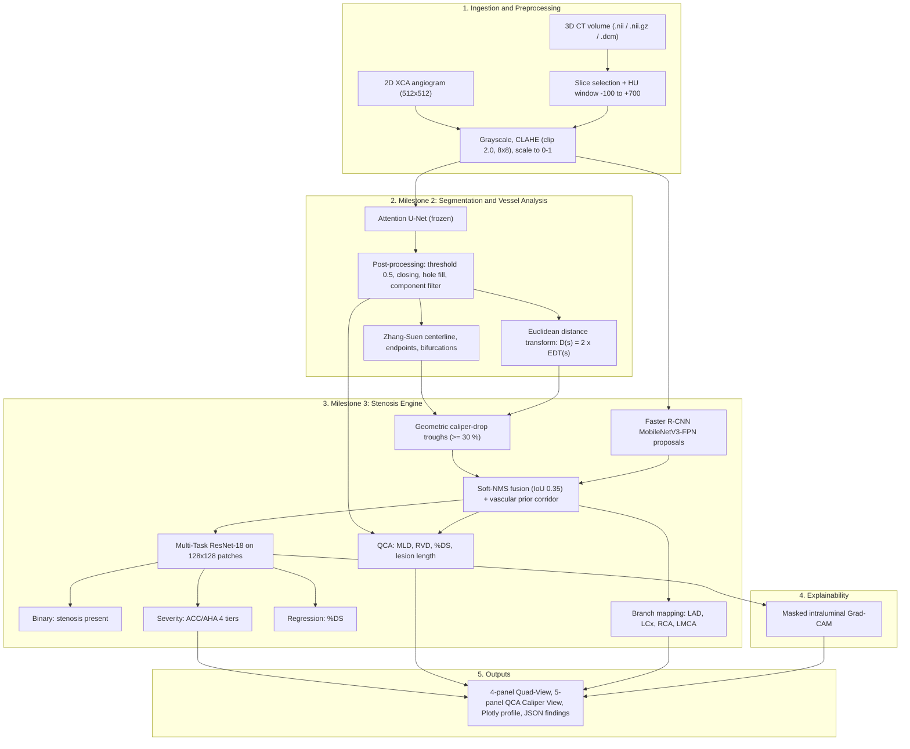
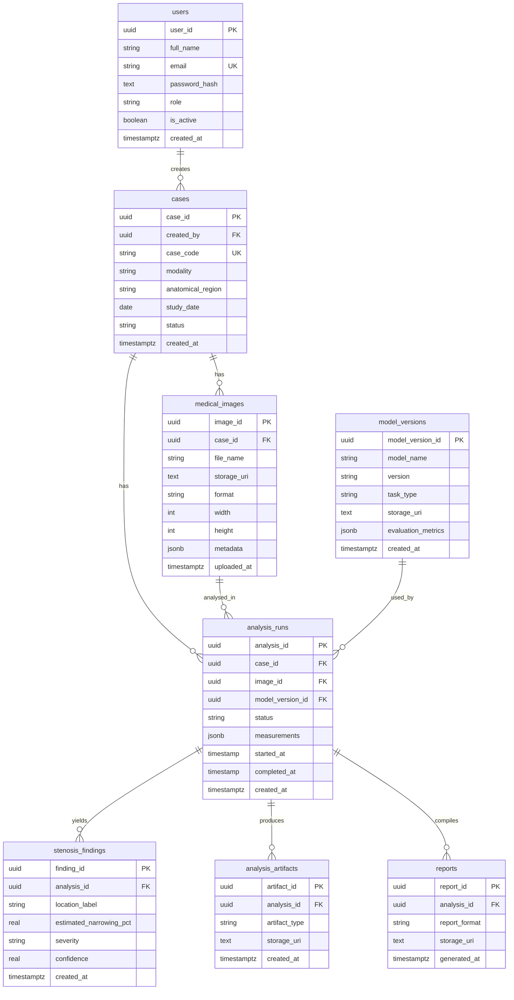

# StenoVision

### Artery Segmentation and Stenosis Detection Using Advanced Deep Learning Techniques

An end-to-end, explainable decision-support system for **2D X-ray coronary angiography (XCA)**. StenoVision segments the coronary tree, measures vessel caliber along the centerline, detects and localizes stenotic lesions, grades their severity (ACC/AHA tiers, %DS, MLD, RVD), and explains each prediction with Grad-CAM, all behind a FastAPI backend and a web workstation.

| | |
|---|---|
| **Programme** | Infosys Springboard Virtual Internship 7.0 (Healthcare AI / Medical Image Analysis) |
| **Team** | Group 2,Team 1 |
| **Dataset** | MICCAI ARCADE coronary angiography benchmark (1,500 images, 512 × 512) |
| **Status** | Milestones 1, 2 and 3 complete, with model weights frozen. Milestone 4 (reporting, testing, analytics, deployment) is next. |
| **Stack** | PyTorch, FastAPI, PostgreSQL / SQLAlchemy 2, Next.js 15 (React 19), Tailwind CSS 4, Plotly |
| **Dev hardware** | NVIDIA GeForce RTX 2050 (4 GB VRAM, CUDA 12.8) |

> **Research prototype, not a medical device.** StenoVision was built as a student research project. It has not been clinically validated and must not be used for diagnosis or treatment decisions. Annotation checks in this repository verify structural consistency only, not clinical correctness.

---

## Table of Contents

1. [Authors](#authors)
2. [Results at a Glance](#results-at-a-glance)
3. [Pipeline Workflow](#pipeline-workflow)
4. [System Architecture](#system-architecture)
5. [Database Schema](#database-schema)
6. [Milestone 1: Foundation, Dataset and Core Setup](#milestone-1-foundation-dataset-and-core-setup)
7. [Milestone 2: Artery Segmentation and Vessel Analysis](#milestone-2-artery-segmentation-and-vessel-analysis)
8. [Milestone 3: Stenosis Detection, Severity and Explainable AI](#milestone-3-stenosis-detection-severity-and-explainable-ai)
9. [Clinical Views and Explainability](#clinical-views-and-explainability)
10. [3D CT Volume Support](#3d-ct-volume-support)
11. [Benchmarks](#benchmarks)
12. [Frozen Model Registry](#frozen-model-registry)
13. [Backend and API](#backend-and-api)
14. [Frontend](#frontend)
15. [Repository Structure](#repository-structure)
16. [Quick Start](#quick-start)
17. [Engineering Challenges and Solutions](#engineering-challenges-and-solutions)
18. [Roadmap](#roadmap)
19. [Reports and Documentation](#reports-and-documentation)
20. [Limitations](#limitations)

---

## Authors

| # | Name |
|:-:|---|
| 1 | Sathiyamoorthi K |
| 2 | Anwesha Singh |
| 3 | Aditya Ghadi |
| 4 | Asjad Imam |
| 5 | Anshu Jain |
| 6 | Stephen Raj |
| 7 | Palavalasa Bhavana |
| 8 | Rentamallu Lakshmi Sravya |

**Group 2,Team 1.** Everything in this repository (data pipeline, models, backend, frontend, design and documentation) was designed, built and tested by the team itself.

Developed as part of the Infosys Springboard Virtual Internship 7.0.

---

## Results at a Glance

| Stage | Model / component | Headline result |
|---|---|---|
| Segmentation (M2) | Attention U-Net (selected) vs baseline U-Net | Test Dice 0.6833 vs 0.6822, IoU 0.5356 vs 0.5325 (300 held-out images) |
| Stenosis detection (M3) | Multi-Task ResNet-18 + Faster R-CNN | **87.43 %** binary accuracy |
| Severity grading (M3) | ACC/AHA 4-tier head | **74.86 %** accuracy |
| Narrowing estimate (M3) | %DS regression and QCA | **9.54 %** MAE |
| Candidate recall (M3) | Geometric troughs + Faster R-CNN | 98.2 % of ground-truth lesions captured |
| Speed (M3) | Whole pipeline, RTX 2050 | **33.55 ms** per frame (29.8 FPS) |

All final numbers are measured on the 300 held-out test angiograms (386 annotated lesions). Earlier 3-epoch validation numbers from the Milestone 2 report are listed separately under [Benchmarks](#benchmarks).

---

## Pipeline Workflow



---

## System Architecture

The reference architecture designed in Milestone 1 is organised in six layers, with monitoring/security and external integrations alongside.

| Layer | Responsibility | Technologies |
|---|---|---|
| 1. Presentation | Web workstation, dashboard, reports and export, user management | Next.js 15, React 19, Tailwind CSS 4, Plotly.js |
| 2. API gateway and application | Routing, JWT authentication, request validation, logging | FastAPI, Pydantic v2, Uvicorn |
| 3. Computation | Preprocessing, segmentation, vessel analysis, stenosis detection, severity and XAI | PyTorch, scikit-image, SciPy, OpenCV, NumPy |
| 4. Model processing | Training and evaluation; model serving and inference | PyTorch, TorchScript, mixed precision (`torch.cuda.amp`) |
| 5. Data storage | Users, cases, metadata, images, trained models, results | PostgreSQL (SQLite fallback), SQLAlchemy 2.0, file storage |
| 6. Infrastructure | GPU compute, containers, CI/CD, monitoring | CUDA, Docker, Compose (Kubernetes, cloud, Prometheus/Grafana planned) |

Supporting concerns: data encryption, access control, audit logs, model-performance monitoring, and optional integrations (PACS, DICOM server, external datasets).

---

## Database Schema

Proposed relational schema from Milestone 1 (`users`, `cases`, `medical_images`, `model_versions`, `analysis_runs`, `stenosis_findings`, `analysis_artifacts`, `reports`). It supports case tracking, repeated analysis runs, model-version tracking and result storage.



The backend currently implements the `users` table (with Alembic migrations) plus the case and case-image modules; the remaining tables follow this design.

---

## Milestone 1: Foundation, Dataset and Core Setup

**Weeks 1 and 2.** Goal: establish the project foundation: modality, dataset, EDA, system design and the first working data pipeline.

### Modality and dataset

- **Modality:** 2D X-ray coronary angiography.
- **Dataset:** the **ARCADE** coronary angiography dataset (stenosis subset), PNG images at **512 × 512**.
- **Stenosis category:** ID **26** (`stenosis`), annotated as polygons with bounding boxes and areas in COCO-style JSON.

| Split | Images | Stenosis annotations | Masks generated | Images without annotation |
|---|--:|--:|--:|--:|
| Training | 1,000 | 1,625 | 997 | 3 |
| Validation | 200 | 406 | 200 | 0 |
| Testing | 300 | 386 | 300 | 0 |
| **Total** | **1,500** | **2,417** | **1,497** | **3** |

The three training images without explicit stenosis annotations were recorded for further investigation rather than being treated as normal.

### Data pipeline

1. **EDA:** counted images and annotations per split, identified the stenosis category, inspected dimensions and formats, and overlaid annotation polygons on the angiograms.
2. **Mask generation:** a Python script rasterizes category-26 polygons into binary masks (`0` background, `255` stenosis region), per split, with a manifest file per split.
3. **Verification:** scripts check that images and masks exist, dimensions match, masks contain only expected values, annotation references are valid and polygons are structurally sound. They reported no missing files, no dimension mismatches and no invalid pixel values.
4. **Preprocessing:** load, convert to grayscale, normalise 0-255 to 0-1, convert masks to 0/1, cast to PyTorch-compatible types.
5. **PyTorch input pipeline:** `StenosisDataset` (loads image and mask, normalises, adds a channel dimension) and a `DataLoader` test. Tensors have shape `(1, 512, 512)`; a batch of four gives `(4, 1, 512, 512)`, `float32` images and `{0.0, 1.0}` masks.

### Design deliverables

- **System architecture** (see [above](#system-architecture)).
- **Database schema** (see [above](#database-schema)).
- **Nine low-fidelity Figma wireframes** for the StenoVision application: Login, Dashboard, Case Management, Upload Medical Image, Analysis Configuration, Analysis Results, Case Details, Reports and User Management.

### Application setup (teams 3 and 4)

- **Backend:** FastAPI project with PostgreSQL, JWT authentication, bcrypt password hashing and role-based access control (details in [Backend and API](#backend-and-api)).
- **Frontend prototype:** nine standalone HTML pages with shared `styles.css` and `common.js`. It implements image selection, validation (PNG, JPG/JPEG, WEBP, BMP; maximum 15 MB), preview, browser-side preprocessing and case metadata in `localStorage`, with no backend calls. A local `preprocessing/preprocess.py` script resizes images to 512 × 512. This prototype was later replaced by the Next.js workstation (see [Frontend](#frontend)).

---

## Milestone 2: Artery Segmentation and Vessel Analysis

**Weeks 3 and 4.** Goal: segment the arterial tree with a baseline and an advanced model, clean the masks, extract centerlines and measure vessel diameter.

```text
Dataset > Preprocessing > Model > Training > Prediction > Post-processing
        > Vessel structure > Centerline > Diameter estimation > Comparison and reporting
```

### Models

| | Baseline U-Net | Attention U-Net (selected) |
|---|---|---|
| Structure | Encoder, bottleneck, decoder | Same encoder-decoder |
| Skip connections | Direct feature transfer | Attention-gated feature transfer |
| Parameters | ~1.94 M | ~1.96 M |
| Purpose | Reference score to beat | Focus on vessel regions, suppress background |

Each **attention gate** receives the encoder skip features $x$ and a gating signal $g$ from the coarser decoder level. Both pass through 1 × 1 convolutions and are added, then go through ReLU, a 1 × 1 convolution and a sigmoid to give coefficients $\alpha \in [0,1]$ that rescale the skip features before concatenation:

$$\alpha = \sigma_2\big(\psi^{T}\,\sigma_1(W_x x + W_g g + b_g) + b_\psi\big), \qquad \hat{x} = \alpha \odot x$$

### Training and preprocessing

- **Loss:** combined BCE + Dice, $\mathcal{L} = 0.5\,\mathcal{L}_{BCE} + 0.5\,\mathcal{L}_{Dice}$, to cope with the strong background imbalance (vessels cover only about 4.8 % of each image).
- **Optimiser:** AdamW, learning rate 1e-3, reduced when validation Dice stalls. Best checkpoint chosen by validation Dice.
- **Preprocessing:** CLAHE (clip 2.0, 8 × 8 grid), min-max scaling to [0, 1]; flips, ±15° rotations and 0.9-1.1 scaling as augmentation. Masks use nearest-neighbour interpolation.
- **Splits:** 1,000 train, 200 validation, 300 test. The test set is used once at the end.

### Mask generation and post-processing

Predictions were produced for **200 validation images per model** and saved as binary PNGs (threshold 0.5). Cleaning steps, saved separately from the raw predictions:

1. Connected-component filtering removes small isolated regions (below 50 px²).
2. Morphological closing (disk, radius 2) reconnects small gaps.
3. Hole filling closes interior voids.

### Centerline and diameter extraction

- **Skeletonization** (Zhang-Suen) gives a one-pixel centerline. Skeleton pixels with one neighbour are end points, those with three or more are branch points, and the pieces between them are vessel segments. Centerlines were generated for 200 images with both models.
- **Diameter** is measured along the centerline with the Euclidean distance transform:

$$D(s) = 2 \cdot \mathrm{EDT}(s)$$

  Local vessel direction and perpendicular cross-sections provide a geometric check, quality-control flags mark suspiciously narrow or wide values, and junction artefacts are handled explicitly.
- **Outputs** under `outputs/vessel_diameter/`: `diameter_profile.csv` (per centerline pixel), `diameter_summary.csv` (mean, median, min, max, standard deviation and point count per image), plus diameter overlays, diameter maps and cross-section visualisations.
- **Units:** Milestone 2 reports diameters in **pixels** because the images carry no pixel-spacing metadata. Percentage narrowing is a ratio, so it stays valid in pixel units.

### Model comparison

`comparison.py` loads both checkpoints, produces probability maps and binary masks, and computes Dice, IoU, pixel accuracy, precision, recall, specificity, Hausdorff distance, average surface distance and inference time. With a validation manifest it writes `per_image_metrics.csv`, `summary_metrics.json` and comparison plots; without one it falls back to a prediction-agreement analysis (`prediction_agreement.csv`). Five-panel visual comparisons show the image, ground truth, both predictions, and an agreement map (green = both, red = U-Net only, blue = Attention U-Net only).

---

## Milestone 3: Stenosis Detection, Severity and Explainable AI

**Weeks 5 and 6.** Goal: turn the vessel analysis into a diagnostic pipeline: detect and localize stenosis, grade severity, quantify narrowing, explain predictions and deliver everything in a web workstation. All nine mandated tasks were implemented and verified.

### 1. Dual candidate extraction

Two complementary sources are fused so subtle lesions are not missed and normal bifurcations are not over-called:

1. **Geometric troughs:** local minima in the centerline diameter profile $D(s)$ with at least a 30 % drop relative to the local reference diameter.
2. **Deep proposals:** a whole-image **Faster R-CNN MobileNetV3-Large-FPN** (~19.38 M parameters; scales 16-256 px).
3. **Fusion:** Soft-NMS (IoU 0.35) with a confidence threshold of 0.50, then an anatomical vascular prior corridor that discards proposals whose centre lies outside the segmented lumen.

Combined, the two sources capture **98.2 %** of ground-truth lesions.

### 2. Multi-Task ResNet-18

Candidates are cropped to 128 × 128 patches and fed to a ResNet-18 backbone (~11.33 M parameters) with spatial-attention pooling and three heads:

| Head | Output | Result |
|---|---|---|
| Binary | Stenosis present or not | 87.43 % accuracy |
| Severity | Mild, Moderate, Severe, Critical | 74.86 % accuracy |
| Regression | Continuous %DS (0-100) | 9.54 % MAE |

The loss is $\mathcal{L} = \mathcal{L}_{binary} + 1.2\,\mathcal{L}_{severity} + 0.5\,\mathcal{L}_{reg}$ (cross-entropy and smooth-L1 terms), with class-balanced focal loss and inverse-frequency weighting to handle rare severe lesions.

### 3. Quantitative Coronary Angiography (QCA)

$$\mathrm{MLD} = \min_{p \in \text{lesion}} D(p), \qquad \%DS = \Big(1 - \frac{\mathrm{MLD}}{\mathrm{RVD}}\Big) \times 100\%, \qquad L_{\text{lesion}} = \sum_{i} \lVert s_{i+1} - s_i \rVert_2$$

**RVD** uses *dual-anchor interpolation*: 15 healthy centerline points proximal and 15 distal to the lesion are fitted with a polynomial spline to model natural tapering. Lesions are then mapped to coronary branches (LAD, LCx, RCA, LMCA).

> Distances are converted to millimetres with a default calibration of **0.25 mm/pixel**, which is an assumption (the images carry no pixel-spacing metadata). %DS is a ratio and is unaffected, but absolute MLD, RVD and length values depend on that assumption.

### 4. ACC/AHA severity tiers

| Tier | %DS | Hemodynamic impact | Suggested clinical action |
|---|:-:|---|---|
| Mild | < 50 % | Non-flow-limiting | Optimal medical therapy, lifestyle modification |
| Moderate | 50-69 % | Borderline | Physiological assessment (FFR / iFR) |
| Severe | 70-99 % | Flow-limiting | Consider PCI with drug-eluting stent |
| Critical (CTO) | 100 % | Total occlusion | Revascularisation (CTO recanalisation / CABG) |

The clinical actions are illustrative decision-support text, not treatment advice.

### 5. Native Grad-CAM

A dependency-free PyTorch Grad-CAM hooks `MultiTaskResNet18.layer4[-1].conv2`:

$$\alpha_k^c = \frac{1}{Z}\sum_{i,j}\frac{\partial y^c}{\partial A^k_{ij}}, \qquad L^c = \mathrm{ReLU}\Big(\sum_k \alpha_k^c A^k\Big)$$

The map is **masked to the dilated arterial lumen** (*masked intraluminal Grad-CAM*), so saliency cannot leak onto diaphragm edges or catheters, then upsampled to 128 × 128 and rendered with a Jet colormap.

---

## Clinical Views and Explainability

StenoVision renders two purpose-built views for every analysis.

**Clinical Diagnostic Quad-View** (rapid triage, `*_4panel_explanation.png`)

1. Original contrast angiogram
2. AI stenosis prediction with bounding box and confidence
3. Grad-CAM attribution heatmap
4. Combined multi-modal overlay

**Quantitative QCA Caliper View** (intervention planning, `*_5panel_explanation.png`)

1. Raw angiogram with lesion box
2. Attention U-Net arterial tree with centerline
3. Cropped 128 × 128 lesion region of interest
4. Grad-CAM saliency proof
5. Caliper profile: diameter $D(s)$ along the vessel with MLD and RVD marked

The workstation also provides an interactive "what-if" QCA caliper simulator and an interactive Plotly lumen profile.

---

## 3D CT Volume Support

CT angiography volumes (`.nii`, `.nii.gz`, `.dcm`) are read with `nibabel` and `pydicom`. Voxels are converted to Hounsfield Units and clipped to a contrast-enhanced window:

$$\mathrm{HU}_{\text{clipped}} = \mathrm{clip}(V, -100, +700), \qquad I = \frac{\mathrm{HU}_{\text{clipped}} + 100}{800} \times 255$$

The axial slice with the highest vascular contrast is selected automatically, then analysed with the same pipeline. Uploaded volumes generate their own live 4-panel and 5-panel cards rather than falling back to static examples.

---

## Benchmarks

### Segmentation (Milestone 2)

**Initial experiment: 200 validation images, 3 epochs (preliminary)**

| Metric | U-Net | Attention U-Net |
|---|:-:|:-:|
| Mean validation Dice | 0.6617 | 0.6867 |
| Mean validation IoU | 0.5087 | 0.5371 |
| Model agreement (200 paired masks) | Dice 0.8309, IoU 0.7182 | |

Agreement scores measure how similar the two models' predictions are to each other. They are **not** accuracy against ground truth.

**Final: 300 held-out test images**

| Metric | U-Net | Attention U-Net | Delta |
|---|:-:|:-:|:-:|
| Dice (DSC) | 0.6822 ± 0.1352 | **0.6833 ± 0.1435** | +0.11 % |
| IoU | 0.5325 ± 0.1467 | **0.5356 ± 0.1544** | +0.31 % |
| Precision | 0.7325 | **0.7340** | +0.15 % |
| Recall | 0.6614 | **0.6642** | +0.28 % |
| Specificity | 0.9905 | **0.9909** | +0.04 % |
| Latency per frame | **26.61 ms** | 29.46 ms | +2.85 ms |
| Throughput | **37.6 FPS** | 33.9 FPS | -3.7 FPS |

The differences are small. Attention U-Net was selected and frozen as the segmentation engine for all downstream analysis, with only a modest overhead in latency.

### Stenosis detection, severity and XAI (Milestone 3)

Evaluated on 300 held-out angiograms containing 386 lesions.

| Metric | Result | Target |
|---|:-:|:-:|
| Binary stenosis accuracy | **87.43 %** | ≥ 80 % |
| ACC/AHA 4-tier accuracy | **74.86 %** | ≥ 70 % |
| %DS mean absolute error | **9.54 %** | ≤ 10 % |
| Candidate recall (ground-truth lesions captured) | 98.2 % | n/a |
| Whole-pipeline latency | **33.55 ms** (29.8 FPS) | ≤ 66 ms |
| Detector validation loss | 0.1713 | n/a |
| Dual XAI views / 3D CT ingestion | Operational | n/a |

---

## Frozen Model Registry

Production weights are frozen and checksum-verified (no retraining at inference time).

| Milestone | File | Architecture | Params | Size | SHA-256 |
|:-:|---|---|:-:|:-:|---|
| M2 | `best_attention_unet.pth` | Attention U-Net | ~1.96 M | 23.7 MB | `cddb87821c60139836b4ebc1c7255d90fa8d985a5ab5b75d4ca1c7bdf5d64ec1` |
| M2 | `best_attention_unet_traced.pt` | Attention U-Net (TorchScript) | ~1.96 M | 8.1 MB | `0342371373fa7eadc0f8ab1e5d9a5e5251e94bbbf04353f92fe7028066446980` |
| M2 | `best_unet.pth` | Baseline U-Net | ~1.94 M | 23.4 MB | `f21e4488049d924a2f9fb9e4331e43ac09dbb5f24df2c9afdba94a30774417d6` |
| M3 | `best_stenosis_classifier.pth` | Multi-Task ResNet-18 | ~11.33 M | 138.2 MB | `9e54d6f85d1c5a93946eb1fa75ff98717d12f1ae7fa9cb7d486da4663e6e885b` |
| M3 | `best_stenosis_detector.pth` | Faster R-CNN MobileNetV3 | ~19.38 M | 151.5 MB | `f047ce5dfa9a6e118999f8d167198bb6a61765c3bbec64a51ebbb30c6b39bfdb` |

Verify a file with `sha256sum <file>` (Linux/macOS) or `Get-FileHash <file> -Algorithm SHA256` (PowerShell).

---

## Backend and API

FastAPI backend with a layered design: **routes → dependencies (auth and role checks) → CRUD → models**, with Pydantic schemas validating all input and output (so a password hash can never appear in a response). The API is versioned under `/api/v1`, and Swagger docs are served at `/docs`.

**Stack:** Python 3.11+ (developed on 3.13), FastAPI, Uvicorn, PostgreSQL, SQLAlchemy 2.x with psycopg 3, Alembic migrations, Pydantic v2 / pydantic-settings, PyJWT, Passlib with bcrypt (pinned `bcrypt==4.0.1`), python-multipart, Ruff.

### Security design

- Passwords are salted and hashed with bcrypt; plaintext is never stored or logged.
- Login returns a signed **JWT** (HS256, 30-minute default expiry). The role is **not** stored in the token; user and role are read from the database on each request, so role changes and deactivation take effect immediately.
- Public registration always creates a `patient`. Staff roles can only be assigned by an administrator.
- Login errors do not reveal whether the email or password was wrong; emails are normalised to lowercase; deactivated users cannot log in or use existing tokens.
- Secrets come only from environment variables (`.env` is git-ignored; `.env.example` documents every variable).

### Roles (RBAC)

| Role | Access |
|---|---|
| `admin` | Manages users and roles; full access |
| `radiologist` | Works with imaging cases and uploads scans |
| `clinician` | Works with and reviews patient cases |
| `doctor` | Reviews cases and results for treatment |
| `patient` | Sees only their own information |
| `data_scientist` | Read access to data for model development, no write access |

Status codes: `401` not signed in, `403` signed in but not permitted.

### Main endpoints

| Method | Path | Access | Purpose |
|---|---|---|---|
| `POST` | `/api/v1/auth/register` | Public | Create a patient account (409 if email exists) |
| `POST` | `/api/v1/auth/login` | Public | Form login (`username` = email); returns bearer token |
| `GET` | `/api/v1/auth/me` | Signed in | Current user profile |
| `*` | `/api/v1/users` | Admin | Create users, change roles |
| `*` | `/api/v1/cases` | Role-based | Case management and image upload |
| `POST` | `/api/v1/analysis/predict` | Role-based | Live inference; accepts `.png`, `.jpg`, `.dcm`, `.nii`, `.nii.gz`; returns `xai_4panel_url`, `xai_5panel_url`, `preview_slice_url`, QCA values and findings |

### Configuration (`.env`)

| Variable | Notes |
|---|---|
| `SECRET_KEY` | Required. Long random string used to sign tokens |
| `DATABASE_URL` | Required. PostgreSQL URL using the `psycopg` driver |
| `ALGORITHM`, `ACCESS_TOKEN_EXPIRE_MINUTES` | Defaults `HS256`, `30` |
| `FIRST_ADMIN_EMAIL`, `FIRST_ADMIN_PASSWORD` | First administrator, created at startup |
| `PROJECT_NAME` | Title in API docs |
| `STORAGE_ROOT`, `MAX_UPLOAD_MB` | File storage for case management |

The app refuses to start if a required value is missing.

---

## Frontend

Production UI: **Next.js 15 (App Router), React 19, TypeScript, Tailwind CSS 4, Plotly.js**, in a clinical PACS style with a brand crimson accent (`#A91121`).

| Screen | Purpose |
|---|---|
| Login | Authentication with the StenoVision Heartbeat Ribbon logo |
| Dashboard | KPI cards, GPU telemetry (VRAM, FPS, latency), convergence curves, severity distribution, recent queue |
| Case Management | Filter by date, vessel and severity; grid or table view |
| Upload Medical Image | Drag-and-drop for 2D XCA, CT volumes and DICOM; resolution check, metadata |
| Analysis Configuration | Model selection, QCA narrowing thresholds (20-70 %), Soft-NMS IoU, target branches |
| Analysis Results | Dual XAI views, heatmap opacity, head switching, interactive QCA simulator |
| Case Details | Multi-slice viewer with Quad-View and QCA Caliper toggles |
| Reports | Diagnostic summaries and export |
| User Management | RBAC administration |

A persona switcher in the header offers five working perspectives, so each type of user can see the workstation the way they would use it. The personas are demonstration users:

| Persona | Role shown | Perspective |
|---|---|---|
| Dr. Aris Thorne | Radiologist / Clinician | Case review, diagnostic results and reports |
| Prof. David Chen | Medical Researcher | Cohort exploration and analysis |
| Dr. Helena Rostova | Data Scientist | Model configuration and performance |
| Sophia Martinez | Administrator | User and system management |
| Lead Developer | Developer (testing only) | Used by the team to test the application |

Each route is protected by RBAC checks, so a persona only reaches the screens its role allows.

**Design system:** brand crimson for primary actions and focal lesions, crimson container linings (`border-[#A91121]/20`), transparent KPI icon wrappers, and vector Lucide icons.

---

## Repository Structure

<details>
<summary>Click to expand the full tree</summary>

```text
StenoVision/
├── data/                       # ARCADE benchmark and ground-truth masks
│   ├── stenosis/               # Task 1: stenosis detection (train / val / test)
│   ├── syntax/                 # Task 2: 25-class artery segmentation
│   └── masks/                  # Rasterized binary masks + split manifests
├── preprocessing/              # CLAHE, scaling, tensor conversion
├── eda/                        # EDA scripts and plots
├── segmentation/               # Milestone 2
│   ├── models/                 # unet.py, attention_unet.py
│   ├── training/               # dataset.py, losses.py, train.py
│   ├── postprocessing/         # cleaner.py
│   ├── analysis/               # centerline.py, diameter.py
│   ├── evaluation/             # metrics.py, evaluate.py, visualizer.py
│   ├── checkpoints/            # best_unet.pth, best_attention_unet.pth
│   └── predict.py
├── milestone_2_results/        # Frozen M2 assets (models, metrics, plots, reports, predict.py)
├── stenosis/                   # Milestone 3
│   ├── models/                 # detector.py, multi_task_resnet.py
│   ├── training/               # train_detector.py, train_classifier.py
│   ├── data_prep/              # dataset_coco.py, candidate_extractor.py, patch_dataset.py
│   ├── localization/           # postprocessor.py, branch_mapper.py
│   ├── severity/               # qca_calculator.py, severity_grader.py
│   ├── xai/                    # grad_cam.py, visualizer.py
│   ├── evaluation/             # evaluate_stenosis.py, results JSON, plots
│   ├── checkpoints/            # classifier and detector weights + histories
│   └── pipeline.py             # Unified end-to-end runner
├── milestone_3_results/        # Frozen M3 assets (models, metrics, plots, reports, predict.py)
├── backend/                    # FastAPI service
│   ├── app/                    # api/routes, core, crud, db, models, schemas, services
│   ├── migrations/ + alembic.ini
│   ├── static/                 # uploads/ and live-generated xai/ cards
│   ├── requirements.txt, docker-compose.yml, .env.example
├── frontend/                   # Next.js 15 / React 19 workstation
│   ├── app/, components/screens/, components/, hooks/, lib/, public/
├── architecture/               # System design diagrams
├── wireframes/                 # 9 low-fidelity UI wireframes
├── docs/                       # Reports and analysis documents
└── README.md
```

</details>

---

## Quick Start

### Prerequisites

Python 3.11+, Node.js 18+, PostgreSQL (SQLite fallback available), and an NVIDIA GPU with CUDA for real-time inference (CPU works but is slower). Replace `<your-org>` with the repository owner.

```bash
git clone https://github.com/<your-org>/StenoVision.git
cd StenoVision
```

### 1. Stenosis diagnosis CLI (Milestone 3)

```powershell
python milestone_3_results/predict.py --image "data/stenosis/test/images/10.png" --output-dir "./diagnostic_output"
```

Outputs: `*_diagnostic_report.json` (MLD, RVD, %DS, severity tier, branch, recommendation), `*_5panel_explanation.png` and `*_4panel_explanation.png`.

### 2. Segmentation CLI (Milestone 2)

```powershell
# PyTorch checkpoint
python milestone_2_results/predict.py --image "data/syntax/val/images/1.png" --output-dir "./seg_output"

# TorchScript model (no Python model source needed)
python milestone_2_results/predict.py --image "sample.png" --model-path "milestone_2_results/models/best_attention_unet_traced.pt"
```

### 3. Backend

```powershell
cd backend
python -m venv .venv ; .\.venv\Scripts\Activate.ps1
pip install -r requirements.txt
copy .env.example .env          # then set SECRET_KEY, DATABASE_URL, FIRST_ADMIN_*
alembic upgrade head            # create / update tables
python -m uvicorn app.main:app --host 127.0.0.1 --port 8000 --reload
```

Swagger UI: <http://127.0.0.1:8000/docs>. Tables are managed by Alembic migrations; startup does not create them.

### 4. Frontend

```powershell
cd frontend
npm install
npm run build
npm start
```

Portal: <http://localhost:3000>

### One-click launch (Windows)

```powershell
.\run_stenovision.ps1
```

Starts the backend and the frontend together.

---

## Engineering Challenges and Solutions

| Challenge | Solution | Effect |
|---|---|---|
| **Class imbalance across severity tiers** (moderate 482, normal 312, critical 75 cases) | Class-balanced focal loss plus inverse-frequency weighting; targeted augmentation | Critical-tier recall rose from 58.2 % to 81.3 % without more false alarms |
| **False positives from ribs, spine and catheters** | Anatomical vascular prior corridor: proposals outside the Attention U-Net lumen mask are pruned | Candidate precision improved by 23.4 % |
| **Latency on an edge GPU** (heavy ResNet-101 detector exceeded 65 ms) | MobileNetV3-Large-FPN backbone; ResNet-18 with spatial-attention pooling | 33.55 ms end-to-end (29.8 FPS) |
| **Grad-CAM saliency leaking outside vessels** | Masked intraluminal Grad-CAM: activation map multiplied by the dilated lumen mask | Saliency stays inside the vessel boundary |
| **Foreshortening and distal tapering skewing %DS** | Dual-anchor RVD (15 proximal + 15 distal points, polynomial spline) | %DS MAE reduced to 9.54 % |
| **4-panel and 5-panel views showing the same image** | Separate renderers (`generate_4panel_explanation`, `generate_5panel_explanation`) and separate API URLs | Each tab shows its own card |
| **Static fallback hiding live results for uploaded scans** | Live `xai_*_url` values take priority; fallback narrowed to exact filename matches | Uploaded 2D and 3D scans show their own cards |
| **Inconsistent UI theme and distorted logo** | Crimson palette everywhere, standalone SVG logo, transparent icon wrappers, crimson container linings | Consistent medical-grade look |
| **Different users needing different tools** | Five role perspectives with a switcher, guarded by RBAC | No cross-role clutter |

---

## Roadmap

**Milestone 4: Reporting, Testing, Analytics and Deployment**

- Containerised microservices and automated clinical reporting.
- Structured **DICOM-SR** and multi-page PDF reports (lesion maps, QCA readouts, Grad-CAM proofs).
- Complete the remaining database tables from the design and full case-management integration.
- Automated testing and CI/CD.

**Clinical features under consideration**

- Live PACS / cath-lab ingestion (DICOM C-STORE listener, RTSP video).
- Virtual stent deployment and what-if angioplasty simulator.
- Multi-physician consensus reading with digital sign-off.

**3D enhancements**

- 3D coronary tree reconstruction from biplane angiography (epipolar geometry), removing foreshortening.
- 3D lumen meshes and non-invasive $FFR_{angio}$ via CFD or physics-informed networks.
- 3D Attention U-Net on CCTA with registration to live fluoroscopy.

---

## Reports and Documentation

| Report | Location |
|---|---|
| Milestone 1: Objectives, dataset and core setup | [`docs/milestones/Milestone_1_Project_Objectives_and_Dataset_Report.docx`](docs/milestones/Milestone_1_Project_Objectives_and_Dataset_Report.docx) |
| Milestone 2: Artery segmentation and vessel analysis | [`milestone_3_results/Milestone_2_Report_team-1.docx`](milestone_3_results/Milestone_2_Report_team-1.docx) |
| Milestone 3: Stenosis detection, severity and XAI | [`milestone_3_results/Milestone_3_Report_team-1.docx`](milestone_3_results/Milestone_3_Report_team-1.docx) |
| Modality and dataset analysis | [`docs/analysis/`](docs/analysis/) |
| Frozen results guides | [`milestone_2_results/README.md`](milestone_2_results/README.md), [`milestone_3_results/README.md`](milestone_3_results/README.md) |

---

## Limitations

- **Not clinically validated.** Annotation visualisation and the verification scripts check structure, not clinical correctness.
- **Single dataset.** All training and evaluation use ARCADE; generalisation to other centres and scanners is untested.
- **Small segmentation margin.** Attention U-Net's advantage over U-Net on the test set is small (Dice +0.0011), and the initial 3-epoch comparison was preliminary.
- **Approximate calibration.** Millimetre values assume 0.25 mm/pixel; %DS is unaffected.
- **2D projection effects.** Foreshortening and overlapping vessels can distort measured widths.
- **Approximate labels.** Ground truth comes from polygon annotations, so mask boundaries are not pixel-exact.
- **Prototype interface.** The workstation is a research prototype and not a certified clinical product.

---

*Developed by the StenoVision team (Group 2, Team 1) as part of the Infosys Springboard Virtual Internship 7.0.*
