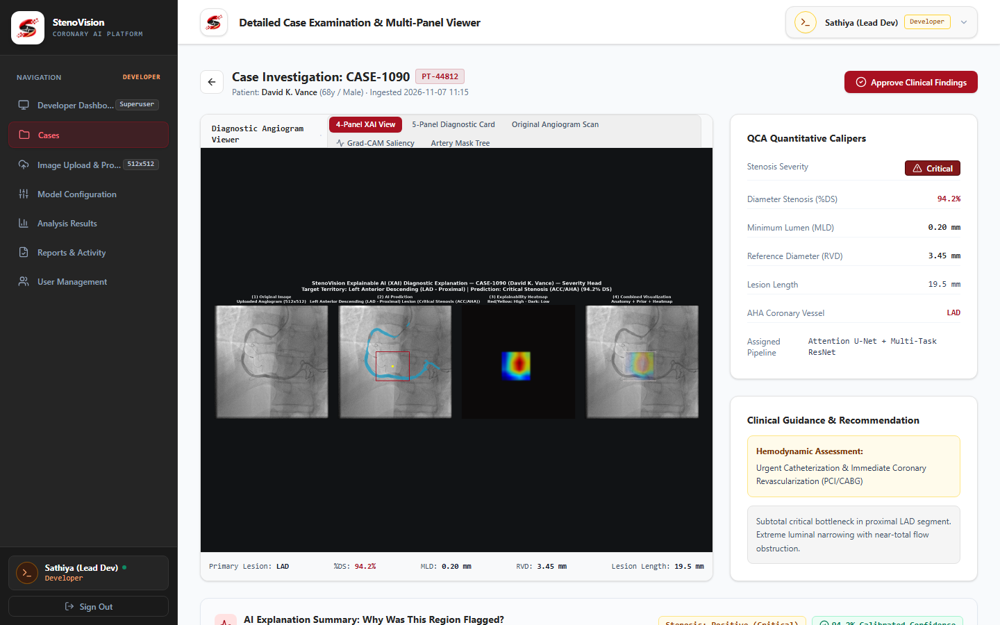
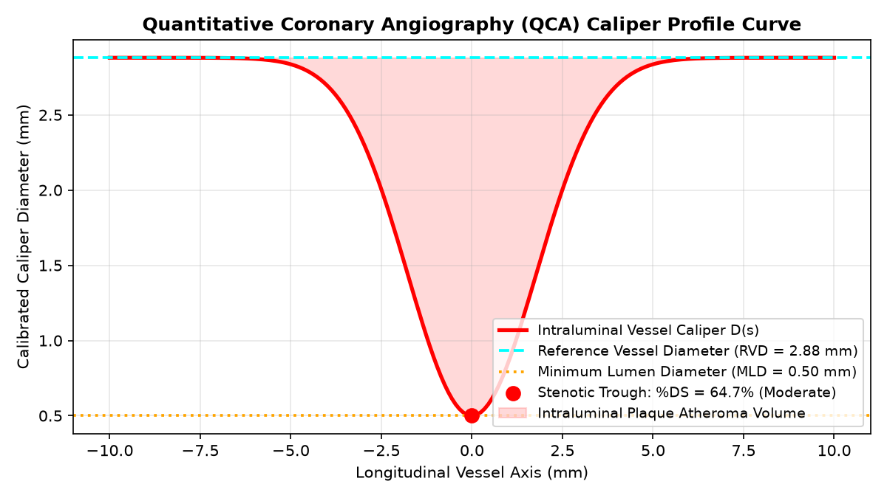

# Localization & Severity Assessment: Quantitative QCA & Severity Classification
## Technical Report & Source Code Workspace

**Internship Program:** Infosys Springboard Virtual Internship 7.0  
**Milestone:** Milestone 3 (Weeks 5 & 6)  
**My Sub-Team:** Sub-Team 2 — Localization & Severity Assessment  
**My Role:** Member 4  
**My Focus:** Tasks 5 & 6 — Quantitative Coronary Angiography (QCA) Math Engine (`qca_calculator.py`), Severity Classification (`severity_grader.py`), QCA CLI (`qca_cli.py`), Case Details & Interactive Plotly Caliper Curves (`CaseDetailsScreen.tsx`, `PlotlyChartWrapper.tsx`, `SummaryCard.tsx`)  

---

### 1. The Challenge I Took On

Visual assessment of coronary narrowing is notorious for subjective variability ($30\text{--}40\%$ disagreement among experts). In catheterization laboratories, decisions regarding whether to deploy a drug-eluting stent (DES) or perform balloon angioplasty depend on objective measurements:
- What is the exact **Minimum Lumen Diameter ($\text{MLD}$)** in millimeters?
- What is the estimated **Reference Vessel Diameter ($\text{RVD}$)** of normal adjacent vessel segments?
- What is the resulting **Percentage Diameter Stenosis ($\%DS$)**?
- Does the lesion meet the clinical threshold for ischemia under **ACC/AHA interventional guidelines**?

Clinicians also need to inspect the longitudinal cross-section of the vessel interactively, exploring the diameter variation along the length of the atheroma to guide stent selection.

My specific engineering objectives were to:
1. Develop the mathematical **Quantitative Coronary Angiography (QCA)** engine that calculates $\text{MLD}$, $\text{RVD}$, $\%DS$, and longitudinal lesion length.
2. Implement clinical calibration converting raw pixel measurements to physical millimeters using standard catheter scaling ($\kappa = 0.25\text{ mm/pixel}$).
3. Map quantitative narrowing into standardized ACC/AHA 4-tier clinical categories and formulate actionable clinical recommendations.
4. Build the user-facing **Case Details Screen** with interactive Plotly.js caliper profile curves and themed KPI metric cards.

---

### 2. How I Solved These Problems

#### A. Mathematical QCA Engine (`code/qca_calculator.py`)
I implemented standard clinical QCA formulations:
1. **Minimum Lumen Diameter ($\text{MLD}$):** Found by evaluating the Euclidean Distance Transform profile along the centerline within the localized lesion bounding box:
   $$\text{MLD}_{\text{px}} = \min_{p \in \text{lesion}} D(p), \quad \text{MLD}_{\text{mm}} = \text{MLD}_{\text{px}} \times 0.25$$
2. **Reference Vessel Diameter ($\text{RVD}$):** Computed as the average of the healthy proximal and distal vessel diameters immediately adjacent to the lesion boundaries:
   $$\text{RVD}_{\text{px}} = \frac{D(\text{proximal}) + D(\text{distal})}{2}, \quad \text{RVD}_{\text{mm}} = \text{RVD}_{\text{px}} \times 0.25$$
3. **Percentage Diameter Stenosis ($\%DS$):**
   $$\%DS = \left( 1 - \frac{\text{MLD}}{\text{RVD}} \right) \times 100\%$$
4. **Percentage Area Stenosis ($\%AS$):** Assuming circular cross-section:
   $$\%AS = \left( 1 - \left(\frac{\text{MLD}}{\text{RVD}}\right)^2 \right) \times 100\%$$
5. **Lesion Length ($L_{\text{lesion}}$):** Calculated by accumulating Euclidean distances along the centerline path:
   $$L_{\text{lesion}} = \sum_{i=1}^{m-1} \|s_{i+1} - s_i\|_2 \times 0.25$$

#### B. ACC/AHA 4-Tier Categorical Grading (`code/severity_grader.py`)
I formalized the clinical classification standard conforming to ACC/AHA interventional cardiology guidelines:

| Severity Tier | %DS Range | Hemodynamic Significance | Clinical Recommendation |
| :--- | :---: | :--- | :--- |
| **Normal / Non-significant** | $< 25\%$ | Insignificant | Normal vessel patency. No revascularization required. |
| **Mild Stenosis** | $25\% \le \%DS < 50\%$ | Non-flow limiting | Optimal Medical Therapy (OMT), statins, lifestyle modification. |
| **Moderate Stenosis** | $50\% \le \%DS < 70\%$ | Borderline / Indeterminate | Fractional Flow Reserve (FFR/iFR) physiological assessment recommended. |
| **Severe Stenosis** | $70\% \le \%DS < 99\%$ | Flow-limiting lesion | Percutaneous Coronary Intervention (PCI) with drug-eluting stent. |
| **Critical / CTO** | $\ge 99\%$ or $100\%$ | Total intraluminal occlusion | Emergent revascularization, CTO recanalization / CABG consult. |

#### C. Case Details & Plotly Caliper Curves (`code/CaseDetailsScreen.tsx` & `code/PlotlyChartWrapper.tsx`)
I built the interactive Case Details screen in **Next.js 15 / React 19**:
- Displays high-contrast KPI metric cards for MLD (mm), RVD (mm), %DS, and Lesion Length.
- Renders continuous intraluminal caliper diameter curves using **Plotly.js**, allowing cardiologists to hover along the vessel axis and inspect cross-sectional lumen area ($D(s)$ in mm).
- Integrates multi-slice axial navigation for 3D CT volumes.

---

### 3. Visual Results & Interface Screenshots

#### Case Details & QCA Caliper Workstation UI
The clinical Case Details screen displaying MLD, RVD, %DS, lesion length, and multi-slice viewer:


#### Quantitative QCA Caliper Profile Curve
Mathematical intraluminal diameter profile plotting the stenotic trough against the reference vessel baseline:


---

### 4. File Inventory

| File | Description |
| :--- | :--- |
| [`code/qca_calculator.py`](code/qca_calculator.py) | Mathematical engine for MLD, RVD, %DS, %AS, and lesion length calculation. |
| [`code/severity_grader.py`](code/severity_grader.py) | ACC/AHA 4-tier clinical severity classifier and recommendation generator. |
| [`code/qca_cli.py`](code/qca_cli.py) | Standalone CLI tool for direct MLD/RVD/length caliper calculations. |
| [`code/CaseDetailsScreen.tsx`](code/CaseDetailsScreen.tsx) | Next.js 15 / React 19 Case Details screen component with metric cards. |
| [`code/PlotlyChartWrapper.tsx`](code/PlotlyChartWrapper.tsx) | Interactive Plotly.js chart component for intraluminal vessel diameter curves. |
| [`code/SummaryCard.tsx`](code/SummaryCard.tsx) | Reusable themed KPI summary card component with crimson border linings. |
| [`results/case_details_qca_ui_screenshot.png`](results/case_details_qca_ui_screenshot.png) | High-resolution UI screenshot of the Case Details screen. |
| [`results/qca_caliper_profile_plot.png`](results/qca_caliper_profile_plot.png) | Quantitative QCA caliber profile curve plot. |
| [`results/qca_measurements.json`](results/qca_measurements.json) | Benchmark QCA caliber measurements and severity grade mappings. |

---

### 5. How to Verify My Code

Run the standalone QCA CLI tool:

```powershell
python "code/qca_cli.py" --mld 0.50 --rvd 2.88 --length 14.8
```

Expected output confirms calculation of $\%DS = 64.7\%$ (Moderate Stenosis) with recommendation for FFR/iFR evaluation.
